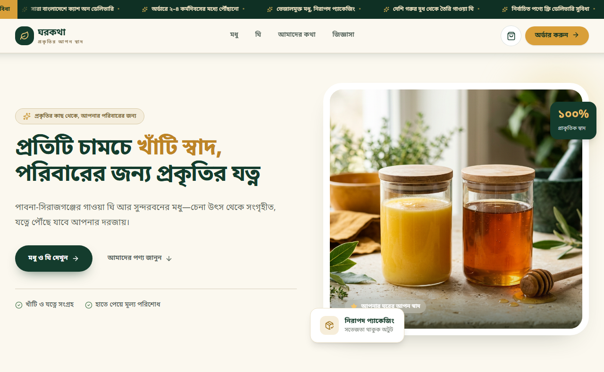
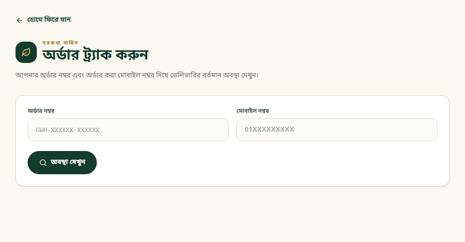

# 🧈 ঘরকথা — Pure Ghee & Sundarbans Honey

**A Bengali-first e-commerce storefront for sourcing and ordering Sundarbans honey and traditional ghee from Pabna–Sirajganj.**

[](https://nextjs.org/)
[](https://react.dev/)
[](https://www.typescriptlang.org/)
[](https://tailwindcss.com/)
[](https://www.mongodb.com/)

---

## 📸 Storefront Preview

| Homepage | Order tracking |
| --- | --- |
|  |  |

---

## 🌿 About

ঘরকথা is a full-stack online shop built around two product collections: honey sourced from the Sundarbans and ghee from the Pabna–Sirajganj region. Customers can browse the catalog, add items to a cart, apply a coupon, place a cash-on-delivery order, and track its status. Store operators can manage products and day-to-day shop activity from a protected admin dashboard.

The interface is Bengali-first, responsive, and designed for Bangladeshi customers, including BDT pricing and delivery zones for Dhaka and locations outside Dhaka.

## ✨ Features

### 🛍️ Storefront

- Browse dedicated honey and ghee collections with product details, pricing, discounts, and availability.
- Add products to a shopping cart and adjust quantities before checkout.
- Place **cash-on-delivery** orders with Dhaka or outside-Dhaka delivery options.
- Apply eligible discount coupons at checkout.
- Track an order using its order number and the phone number used at checkout.
- Read customer reviews, product FAQs, and store information.
- Send a message to the store through the customer enquiry form.
- Responsive layouts, Bengali typography, and mobile navigation.

### 🔐 Admin dashboard

- Review sales and order activity from the dashboard.
- Create, edit, and remove products; manage product image uploads.
- Search orders and update their fulfilment status.
- Manage customer records, messages, customer reviews, and discount coupons.
- Admin pages and management APIs require an authenticated admin session.

### ⚙️ Server and data

- Next.js Route Handlers provide the storefront and admin APIs.
- MongoDB with Mongoose stores products, orders, customers, reviews, messages, and coupons.
- Order totals are calculated from current product and coupon data on the server.
- Preview catalog and review data are available when MongoDB is not configured; database-backed actions such as placing orders and admin management require a MongoDB connection.

## 🧰 Tech Stack

| Area | Technologies |
| --- | --- |
| Framework | Next.js 16 App Router |
| UI | React 19, TypeScript, Tailwind CSS 4 |
| Database | MongoDB, Mongoose |
| Components & icons | Base UI, Lucide React |
| Analytics | Vercel Analytics |
| Package manager | pnpm |

## 🚀 Getting Started

### Prerequisites

- Node.js **20.9.0 or newer**
- pnpm
- A MongoDB connection string for database-backed features

### 1. Clone and install

```bash
git clone https://github.com/saikatghosh3/khati-modhu-ghee.git
cd khati-modhu-ghee
pnpm install
```

### 2. Configure environment variables

Create `.env.local` in the project root:

```dotenv
MONGODB_URI=mongodb+srv://<username>:<password>@<cluster>/<database>
ADMIN_EMAIL=your-admin-email
ADMIN_PASSWORD=replace-with-a-strong-password
```

Use your own MongoDB connection string and admin credentials. Keep `.env.local` private; environment files are excluded from Git.

### 3. Start the development server

```bash
pnpm dev
```

Open [http://localhost:3000](http://localhost:3000). The admin sign-in page is at [http://localhost:3000/admin/login](http://localhost:3000/admin/login).

### 4. Build and run for production

```bash
pnpm build
pnpm start
```

## 🗺️ Application Routes

| Route | Description |
| --- | --- |
| `/` | Storefront and product collections |
| `/track` | Order tracking |
| `/admin/login` | Admin sign-in |
| `/admin/dashboard` | Protected store management |
| `/privacy-policy` | Privacy policy |
| `/terms-and-conditions` | Terms and conditions |

## 🧱 Project Structure

```text
app/
  admin/                 Admin sign-in and dashboard routes
  api/                   Next.js Route Handlers
  privacy-policy/        Privacy policy page
  terms-and-conditions/  Terms page
  track/                 Order tracking page
components/              Storefront, admin, and shared UI
lib/                     Database, catalog, and domain helpers
models/                  Mongoose models
public/
  images/                Product photography and README screenshots
```

## 🔒 Configuration & Security

- Set `ADMIN_EMAIL`, `ADMIN_PASSWORD`, and `MONGODB_URI` in the deployment environment; never put real credentials in source code or screenshots.
- Use a unique, strong admin password and restrict access to production environment settings.
- The application supports cash-on-delivery checkout; no online payment gateway is configured.

---

**Built with care in Bangladesh · ঘরকথা**
